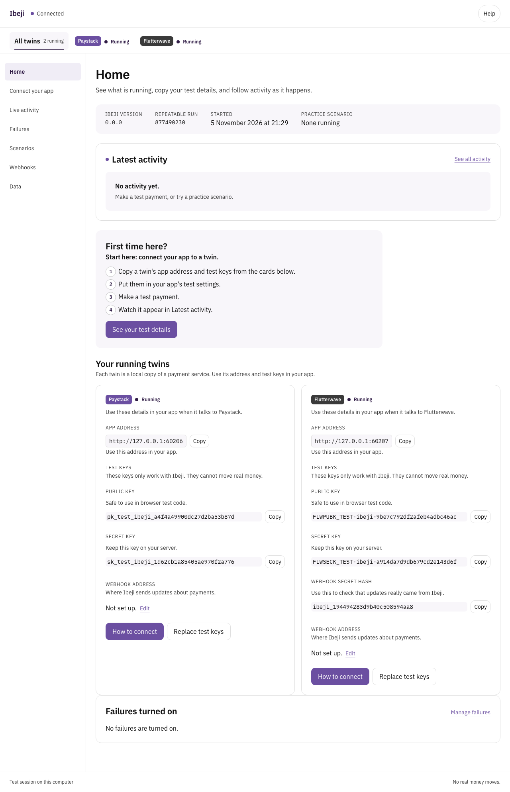
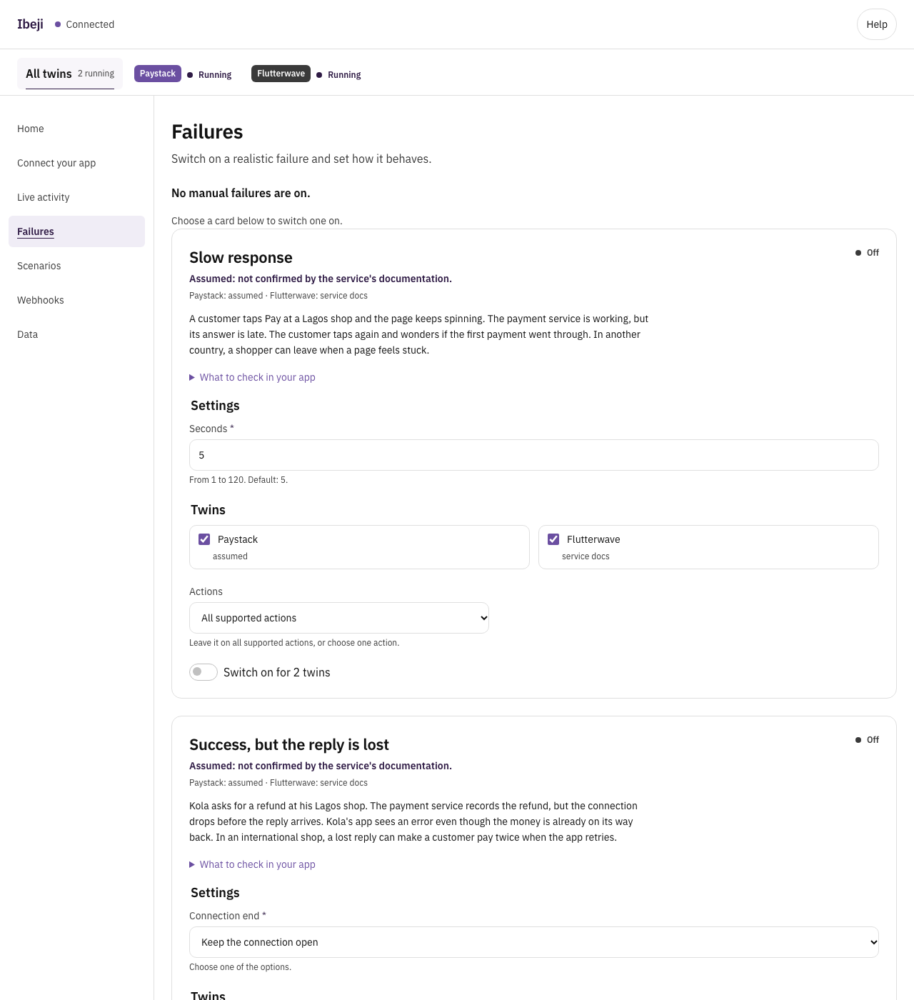

# Ibeji

Ibeji runs local twins of Paystack and Flutterwave so you can test payments, webhooks and realistic failures without real money.



## The gap between test mode and real life

Musa built a school-fees agent for a school in Kaduna. An agent is a program that can take actions for a person.<br>
In test mode every payment confirmed at once, so the agent marked fees paid as soon as a payment started.<br>
A parent's payment failed ten seconds later, but the student was already marked paid.<br>
The bursar found out before Musa did.

Test modes are useful. The problem is that they behave too well: payments confirm at once, webhooks arrive on time, and transfers rarely get stuck. Real services do not always behave that well.

## What a twin is

A twin is a small program on your computer that answers requests the same way a payment service does. It uses the same paths, request shapes, responses and webhooks for the actions Ibeji supports. You point your app at the twin instead of the real service.

A few words used in this README:

- **API:** the set of web addresses and rules an app uses to talk to a payment service.
- **Base URL:** the address your app sends payment requests to. The dashboard calls this the **app address** on Home and the **base URL** on Connect your app.
- **Test key:** a fake key that works only with Ibeji. It cannot move real money.
- **Live key:** a real key from a payment service. It can move real money. Ibeji never accepts one.
- **Webhook:** a message a payment service sends to your app when something happens, such as a successful payment.
- **Failure:** a realistic problem Ibeji can create, such as a late webhook or a declined payment.
- **Scenario:** a ready-made set of failures that tells a story.

## The three twins

| Twin | What it is for | In version 0.1.0 |
|---|---|---|
| **Paystack** | The most used payment service among Nigerian developers. | Built and registered. |
| **Flutterwave** | The other major African payment service, used across many African countries. | Built and registered. It imitates Flutterwave API v3. |
| **Stripe** | The main service for international customers and teams outside Africa. | Not built yet. The Stripe twin is planned for version 0.2.0. |

Ibeji is not affiliated with or endorsed by Paystack, Flutterwave, or Stripe.

## Quick start for non-technical users, about 2 minutes

You need Node.js 22.18 or newer. Node.js is the program that runs Ibeji. Install it from [nodejs.org](https://nodejs.org).

1. Open Terminal on macOS or Linux, or PowerShell on Windows.
2. Run this command:

   ```bash
   npx ibeji start
   ```

3. The dashboard opens in your browser. The terminal also prints a dashboard link. If the browser does not open, copy that link into your browser.
4. On the **Home** page, find the twin you use. Copy its **app address** and **test keys** into your app's test settings. Use the public key in browser test code and the secret key only on your server.
5. Click **How to connect**. It repeats the steps for that twin and has a copy button for every value.
6. Click **Failures**. Choose a failure, set its options, and use the switch to turn it on. Make one test payment and watch **Latest activity**.
7. Click **Webhooks** to set the address in your app that should receive webhook messages.

No real money moves. Ibeji listens only on your computer.

## Quick start for developers

From a source checkout:

```bash
pnpm install
pnpm build
node dist/cli.js start --no-open
```

In another terminal, these commands control the same session:

```bash
node dist/cli.js status
node dist/cli.js fail slow-response --seconds 8 --twin paystack
node dist/cli.js events --follow --twin paystack
```

Press Control and C to stop following events. The installed command is `ibeji`. After the package is installed, use `ibeji` in place of `node dist/cli.js`.

The full command list is in [docs/cli.md](docs/cli.md).

## MCP setup for AI coding agents

MCP is the standard way an AI coding agent uses outside tools. `ibeji mcp` runs an MCP server over stdio.

Start Ibeji first:

```bash
npx ibeji start
```

Then add this to your MCP client's configuration:

```json
{
  "mcpServers": {
    "ibeji": {
      "command": "npx",
      "args": ["-y", "ibeji", "mcp"]
    }
  }
}
```

The MCP server reads `~/.ibeji/session.json` again on every tool call, so it keeps working after Ibeji restarts. It can show the session, failures, scenarios, recent activity, webhook deliveries, test keys and the connection guide for a twin. It can also switch failures on and off, run scenarios, set a webhook URL, resend a webhook and reset twin records.

Only MCP messages go to standard output. Logs go to standard error. The keys returned by the MCP server are Ibeji's fake local test keys. MCP clients may log tool results. Never use a live key with Ibeji.

## When the fixtures were recorded

Fixtures are saved responses from each service's test mode. The twins use them to check request and response shapes. The date is the last recording date.

| Twin | Last recorded | Fixture notes |
|---|---|---|
| **Paystack** | 28 October 2026 | 30 fixture files |
| **Flutterwave** | 28 October 2026 | 28 fixture files |
| **Stripe** | No fixtures yet | The Stripe twin is version 0.2.0. The research date is 28 October 2026. |

## What the dashboard looks like

The Home page shows each running twin, its app address, test keys, webhook address and the newest activity.



The Failures page explains each failure in plain words, shows its settings, and lets you choose the twins and actions.

To regenerate both screenshots, run:

```bash
pnpm build
pnpm screenshots
```

The screenshot script starts a real local session, opens the dashboard with Playwright, writes `docs/images/home.png` and `docs/images/failures.png`, and removes the temporary session.

## Documentation

- [Connect your app](docs/connect-your-app.md): point an app at each twin, with a ready-to-paste instruction for a coding agent.
- [Safety](docs/safety.md): what Ibeji never does, including the live-key rule and webhook address rules.
- [Limits](docs/limits.md): what is not supported yet for each twin.
- [CLI](docs/cli.md): every command with an example.
- [Stripe and Ibeji](docs/stripe-and-ibeji.md): what Stripe's own testing tools already do and what Ibeji adds.
- [Failure library](docs/failures.md): every failure, its story, settings and supported twins.
- [Scenarios](docs/scenarios.md): every built-in scenario.
- [School fees example app](examples/school-fees-app/README.md): Musa's bug in naive mode and the correct behaviour in safe mode.
- [Changelog](CHANGELOG.md): release notes.

The failure library and scenario pages are generated by `scripts/generate-docs.mjs`. Do not edit them by hand.

## Development

Run the checks:

```bash
pnpm typecheck
pnpm lint
pnpm test
pnpm test:ui
pnpm check:package
pnpm test:smoke
```

The UI tests and the screenshot script need a separate Playwright browser. Users do not need it. Install it once with:

```bash
pnpm exec playwright install chromium
```

Ibeji is licensed under the MIT licence. See [LICENSE](LICENSE).
